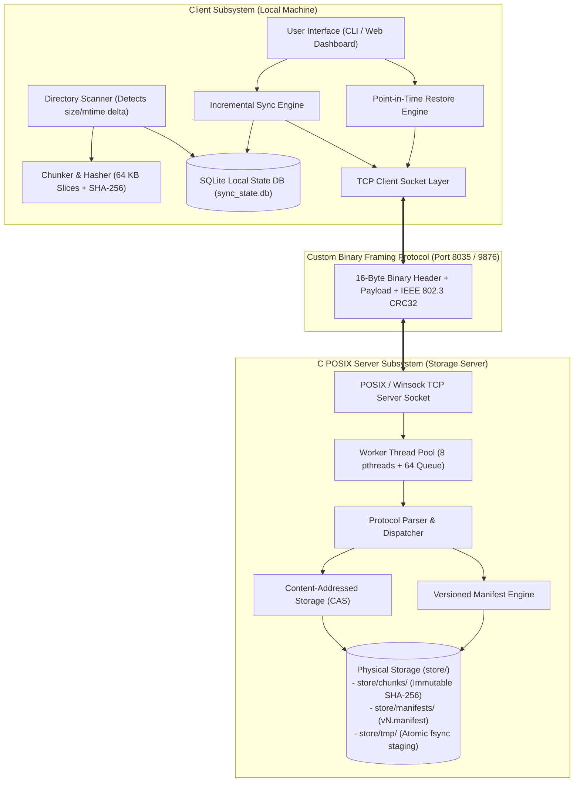
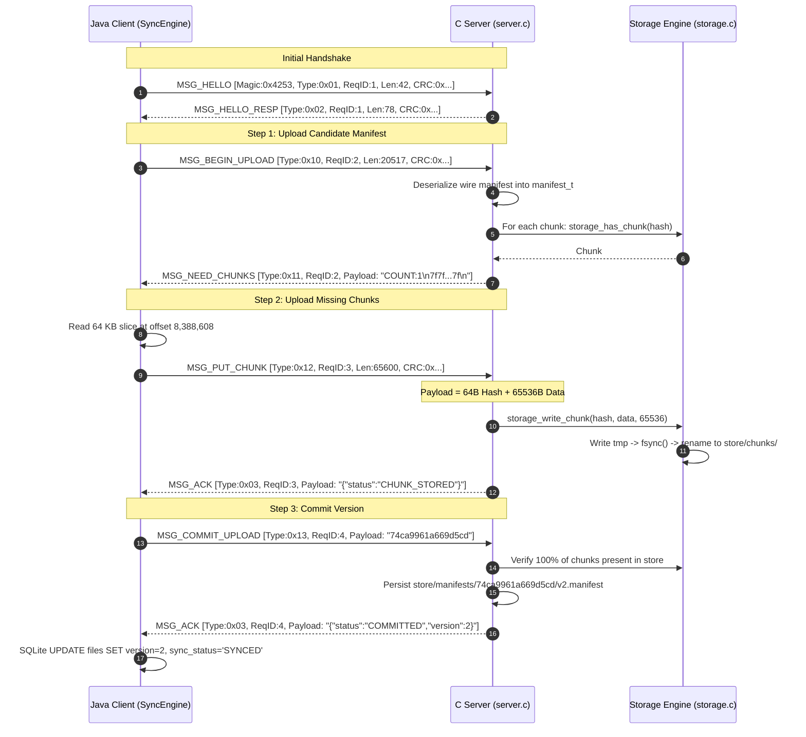
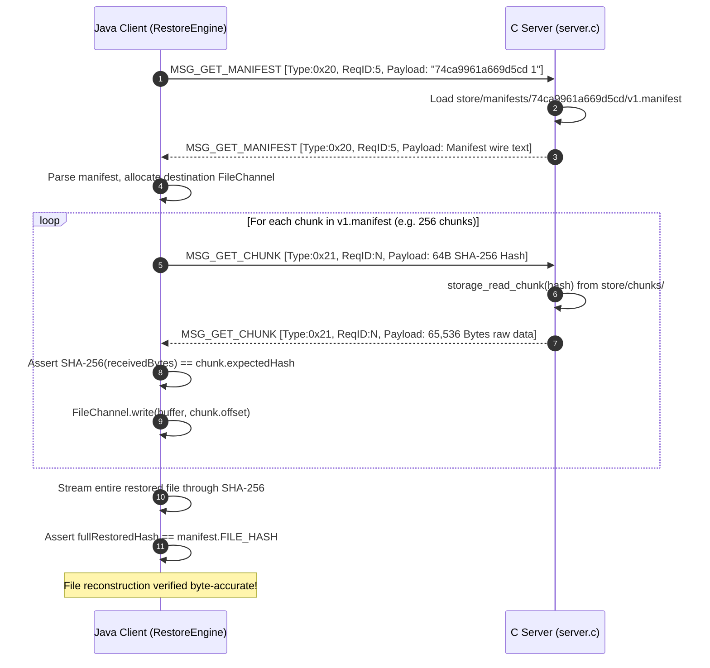

# Distributed Backup, Synchronization & Recovery System
## Complete Engineering Specification, Codebase Structure & Operational Mechanics

---

## 1. System Overview & Architectural Topology

This document provides an exhaustive, end-to-end breakdown of the **Distributed Backup, Synchronization & Recovery System**. It details every source file, data structure, function, network transfer mechanism, chunk calculation, storage rule, and dashboard workflow.

### 1.1 Architectural High-Level Design



---

## 2. Exhaustive Code Structure & File-by-File Breakdown

Below is the complete file-by-file blueprint of the entire codebase. For every file, this section details its **purpose**, **inputs/parameters (what we provide)**, **outputs/return values (what it produces)**, **data structures**, and **internal operational logic**.

```text
/home/karan/Data/Academics/sem-5/Mini-project/CN/Source/
├── server/
│   ├── Makefile                         # Cross-platform compiler build script
│   ├── include/
│   │   ├── protocol.h                   # 16-Byte frame header, opcodes & limits
│   │   ├── net.h                        # POSIX/Winsock socket abstractions
│   │   ├── crc32.h                      # IEEE 802.3 CRC32 checksum interface
│   │   ├── hash.h                       # Self-contained SHA-256 interface
│   │   ├── storage.h                    # Content-addressed chunk store interface
│   │   ├── manifest.h                   # Versioned manifest engine interface
│   │   └── threadpool.h                 # Bounded worker thread pool interface
│   └── src/
│       ├── protocol.c                   # Header serialize/deserialize (Big-Endian)
│       ├── net.c                        # recv_exact() and send_all() socket loops
│       ├── crc32.c                      # Precomputed 256-entry CRC32 lookup table
│       ├── hash.c                       # Portable SHA-256 hashing implementation
│       ├── storage.c                    # Atomic chunk write (tmp -> fsync -> rename)
│       ├── manifest.c                   # Manifest serialization, parsing & versions
│       ├── threadpool.c                 # pthreads worker pool with mutex & condvars
│       ├── server.c                     # Server entry point, TCP listener & routing
│       └── test_storage.c               # Self-contained unit & integration test runner
├── client/
│   ├── bin/                             # Compiled Java bytecode class files
│   ├── lib/                             # External JDBC & logging JAR libraries
│   │   ├── sqlite-jdbc-3.45.2.0.jar
│   │   ├── slf4j-api-2.0.12.jar
│   │   └── slf4j-simple-2.0.12.jar
│   ├── src/main/
│   │   ├── java/com/backup/
│   │   │   ├── model/
│   │   │   │   ├── Chunk.java           # Immutable model for a single 64 KB chunk
│   │   │   │   └── FileSnapshot.java    # Model for file version and chunk lists
│   │   │   ├── crypto/
│   │   │   │   └── HashUtil.java        # SHA-256 digest & hex conversion helper
│   │   │   ├── protocol/
│   │   │   │   ├── MessageType.java     # Protocol opcode enumeration
│   │   │   │   ├── FrameHeader.java     # 16-byte binary header encode/decode
│   │   │   │   ├── ProtocolFrame.java   # Composite header + payload container
│   │   │   │   ├── Crc32Util.java       # IEEE 802.3 CRC32 computation
│   │   │   │   └── ManifestWireUtil.java# Wire manifest serializer & deserializer
│   │   │   ├── net/
│   │   │   │   └── BackupClientConnection.java # Java NIO TCP client socket channel
│   │   │   ├── storage/
│   │   │   │   ├── FileChunker.java     # Slices files into 64 KB blocks & hashes
│   │   │   │   ├── DirectoryScanner.java# Fast directory scanner with stat caching
│   │   │   │   └── LocalStateDatabase.java # SQLite WAL engine for local state
│   │   │   ├── sync/
│   │   │   │   ├── SyncEngine.java      # Incremental upload pipeline
│   │   │   │   └── SyncReport.java      # Performance metrics and dedup statistics
│   │   │   ├── restore/
│   │   │   │   ├── RestoreEngine.java   # Point-in-time file recovery engine
│   │   │   │   └── RestoreReport.java   # Restore performance and integrity report
│   │   │   ├── web/
│   │   │   │   └── DashboardServer.java # Virtual-thread HTTP server & REST APIs
│   │   │   ├── ClientMain.java          # Phase 1: Protocol framing test driver
│   │   │   ├── Phase2TestMain.java      # Phase 2: Chunker & SQLite test driver
│   │   │   ├── Phase3SyncTestMain.java  # Phase 3: Incremental sync test driver
│   │   │   └── Phase4RestoreAndUiMain.java # Phase 4: Restore & UI test driver
│   │   └── resources/web/
│   │       └── index.html               # Single-page glassmorphism dashboard UI
│   └── sync_state.db                    # Active SQLite database file
└── store/                               # Server Content-Addressed Storage root
    ├── chunks/                          # Immutable chunk storage (named by SHA-256)
    ├── manifests/                       # Historical version manifests (v1, v2, ...)
    └── tmp/                             # Atomic write staging directory
```

---

### 2.1 Server Components (C POSIX)

#### 1. [`server/include/protocol.h`](file:///home/karan/Data/Academics/sem-5/Mini-project/CN/Source/server/include/protocol.h) & [`server/src/protocol.c`](file:///home/karan/Data/Academics/sem-5/Mini-project/CN/Source/server/src/protocol.c)
* **Functionality:** Defines the core application-layer framing standard, protocol magic bytes, frame header length (16 bytes), max payload limit (16 MB), opcode enumerations, and provides serialization/deserialization functions.
* **Key Structures:**
  ```c
  typedef struct {
      uint16_t magic;        // 0x4253 ('B', 'S')
      uint8_t  version;      // 0x01
      uint8_t  type;         // message_type_t opcode
      uint32_t request_id;   // Monotonic correlation ID
      uint32_t payload_len;  // Length in bytes (0 to 16,777,216)
      uint32_t crc32;        // IEEE 802.3 CRC32 of payload
  } frame_header_t;
  ```
* **What We Give (Input):**
  * `serialize_header(const frame_header_t *hdr, uint8_t *out_buf)`: Takes a populated header struct in host memory and a 16-byte output buffer.
  * `deserialize_header(const uint8_t *in_buf, frame_header_t *hdr)`: Takes 16 raw bytes received from the network socket and a destination struct pointer.
* **What It Produces (Output):**
  * `serialize_header`: Encodes the header into 16 network-byte-order (Big-Endian) bytes.
  * `deserialize_header`: Returns `0` on success, `-1` on null pointer, `-2` if magic mismatch (`hdr->magic != 0x4253`), `-3` if unsupported version, or `-4` if payload length exceeds 16 MB.

---

#### 2. [`server/include/net.h`](file:///home/karan/Data/Academics/sem-5/Mini-project/CN/Source/server/include/net.h) & [`server/src/net.c`](file:///home/karan/Data/Academics/sem-5/Mini-project/CN/Source/server/src/net.c)
* **Functionality:** Provides portable socket operations across POSIX Linux and Windows Winsock (`_WIN32`). Solves TCP stream fragmentation by guaranteeing exact byte count reads and complete writes.
* **Key Functions:**
  * `net_listen(const char *bind_addr, int port, int backlog)`: Creates a socket, sets `SO_REUSEADDR`, binds to the specified IP/port, and enters listen mode. Returns listening file descriptor `socket_t` or `-1`.
  * `recv_exact(socket_t fd, void *buf, size_t len)`: Loops `recv()` until exactly `len` bytes have been accumulated into `buf`.
    * **Input:** Socket descriptor `fd`, target buffer `buf`, expected count `len`.
    * **Output:** Returns `len` on full success, `0` if client closed cleanly, or `-1` on socket failure.
  * `send_all(socket_t fd, const void *buf, size_t len)`: Loops `send()` until all `len` bytes are committed to the TCP send buffer. Returns `0` on success, `-1` on failure.

---

#### 3. [`server/include/crc32.h`](file:///home/karan/Data/Academics/sem-5/Mini-project/CN/Source/server/include/crc32.h) & [`server/src/crc32.c`](file:///home/karan/Data/Academics/sem-5/Mini-project/CN/Source/server/src/crc32.c)
* **Functionality:** Implements the IEEE 802.3 standard cyclic redundancy check polynomial:
  $$P(x) = x^{32} + x^{26} + x^{23} + x^{22} + x^{16} + x^{12} + x^{11} + x^{10} + x^8 + x^7 + x^5 + x^4 + x^2 + x + 1$$
  Using polynomial constant `0xEDB88320L` (reversed representation).
* **Key Functions:**
  * `crc32_init()`: Computes the 256-entry lookup table at server startup.
  * `crc32_compute(const uint8_t *data, size_t length)`: Computes the checksum over the buffer.
    * **Input:** Raw byte buffer, buffer length.
    * **Output:** 32-bit unsigned integer checksum matching Java's `java.util.zip.CRC32`.

---

#### 4. [`server/include/hash.h`](file:///home/karan/Data/Academics/sem-5/Mini-project/CN/Source/server/include/hash.h) & [`server/src/hash.c`](file:///home/karan/Data/Academics/sem-5/Mini-project/CN/Source/server/src/hash.c)
* **Functionality:** High-performance, portable implementation of the NIST FIPS 180-4 SHA-256 cryptographic hash standard. Eliminates external OpenSSL library dependencies.
* **Key Functions:**
  * `sha256_compute(const void *data, size_t len, uint8_t digest[32])`: Generates the raw 32-byte digest.
  * `sha256_to_hex(const uint8_t digest[32], char hex_out[65])`: Converts 32 binary bytes into a null-terminated 64-character lowercase hexadecimal string.
  * `sha256_compute_hex(const void *data, size_t len, char hex_out[65])`: Convenience one-shot wrapper taking input data and directly returning the 64-character hex string.

---

#### 5. [`server/include/storage.h`](file:///home/karan/Data/Academics/sem-5/Mini-project/CN/Source/server/include/storage.h) & [`server/src/storage.c`](file:///home/karan/Data/Academics/sem-5/Mini-project/CN/Source/server/src/storage.c)
* **Functionality:** Implements the Content-Addressed Storage (CAS) engine. Guarantees that chunks are immutable and written atomically to disk.
* **Directory Layout Managed:**
  * `./store/chunks/`: Permanent chunk files named by their 64-char SHA-256 hex string.
  * `./store/tmp/`: Staging directory for atomic writes.
  * `./store/manifests/`: Versioned manifest directory tree.
* **Key Functions:**
  * `storage_init(const char *base_path)`: Creates base directories (`chunks`, `tmp`, `manifests`) with permissions `0755`. Returns `0` on success.
  * `storage_has_chunk(const char *chunk_hash_hex)`: Checks if `./store/chunks/<hash>` exists. Returns `1` if exists, `0` if missing, `-1` on error.
  * `storage_write_chunk(const char *chunk_hash_hex, const uint8_t *data, size_t len)`:
    * **Input:** Expected SHA-256 hex hash, raw data bytes, length.
    * **Internal Logic:**
      1. Hashes `data` and verifies `computed_hash == chunk_hash_hex`. If mismatched, returns `-2` (integrity violation).
      2. If chunk already exists in `./store/chunks/`, returns `0` immediately (zero-cost deduplication).
      3. Writes payload to `./store/tmp/<hash>.<rand>.<len>.tmp`.
      4. Executes `fflush()` followed by POSIX `fsync(fileno(f))` (`_commit()` on Windows) to force physical persistence.
      5. Executes atomic POSIX `rename(tmp_path, target_path)`.
    * **Output:** `0` on success, `-1` on I/O error, `-2` on corruption.
  * `storage_read_chunk(const char *chunk_hash_hex, uint8_t **out_data, size_t *out_len)`:
    * **Input:** 64-character chunk hash.
    * **Internal Logic:** Reads `./store/chunks/<hash>` into a freshly allocated memory buffer, computes its SHA-256, and verifies it matches the filename before returning.
    * **Output:** Returns `0` on success, `-1` on read failure, `-2` on disk corruption.

---

#### 6. [`server/include/manifest.h`](file:///home/karan/Data/Academics/sem-5/Mini-project/CN/Source/server/include/manifest.h) & [`server/src/manifest.c`](file:///home/karan/Data/Academics/sem-5/Mini-project/CN/Source/server/src/manifest.c)
* **Functionality:** Manages versioned manifest metadata records that describe how to assemble chunks into full files.
* **Key Structures:**
  ```c
  typedef struct {
      uint64_t offset;
      uint32_t length;
      char chunk_hash[65];
  } manifest_chunk_t;

  typedef struct {
      char file_id[128];
      char file_path[512];
      uint64_t timestamp;
      uint64_t file_size;
      char whole_file_hash[65];
      uint32_t chunk_count;
      manifest_chunk_t *chunks;
  } manifest_t;
  ```
* **Key Functions:**
  * `manifest_serialize(const manifest_t *m)`: Serializes a manifest struct into the standard line-oriented wire format. Returns a heap-allocated string.
  * `manifest_deserialize(const char *data)`: Parses a wire-format manifest text payload back into an allocated `manifest_t` structure.
  * `manifest_save_version(const char *base_path, const manifest_t *m, uint32_t version)`: Persists manifest into `./store/manifests/<file_id>/v<version>.manifest`. Returns `0` on success.
  * `manifest_load_version(const char *base_path, const char *file_id, uint32_t version)`: Loads and deserializes `./store/manifests/<file_id>/v<version>.manifest`.
  * `manifest_get_latest_version(const char *base_path, const char *file_id)`: Scans the directory `./store/manifests/<file_id>/` and returns the highest version integer `N` found (e.g. `2`). Returns `0` if no versions exist.

---

#### 7. [`server/include/threadpool.h`](file:///home/karan/Data/Academics/sem-5/Mini-project/CN/Source/server/include/threadpool.h) & [`server/src/threadpool.c`](file:///home/karan/Data/Academics/sem-5/Mini-project/CN/Source/server/src/threadpool.c)
* **Functionality:** Thread pool architecture handling client connections concurrently using POSIX pthreads.
* **Architecture:**
  * Fixed thread count: `8` worker threads.
  * Bounded FIFO task queue: `64` connection slots.
  * Synchronization primitives:
    * `pthread_mutex_t lock`: Guards queue state.
    * `pthread_cond_t notify_not_empty`: Wakes idle threads when work arrives.
    * `pthread_cond_t notify_not_full`: Blocks listener if queue capacity is reached.
* **Key Functions:**
  * `threadpool_create(int thread_count, int queue_capacity)`: Allocates and starts worker threads.
  * `threadpool_add(threadpool_t *pool, threadpool_task_fn fn, void *arg)`: Pushes a task to the queue. Blocks if full; returns `-1` on shutdown.
  * `threadpool_destroy(threadpool_t *pool, int graceful)`: Joins worker threads and releases memory.

---

#### 8. [`server/src/server.c`](file:///home/karan/Data/Academics/sem-5/Mini-project/CN/Source/server/src/server.c)
* **Functionality:** Main application entry point for the C POSIX backend server.
* **Execution Flow:**
  1. Initializes networking subsystem (`net_init()`).
  2. Generates CRC32 table (`crc32_init()`).
  3. Initializes storage directories (`storage_init("./store")`).
  4. Registers `SIGINT` / `SIGTERM` handlers for graceful teardown.
  5. Spawns thread pool (8 threads, queue capacity 64).
  6. Creates TCP socket listening on `0.0.0.0:8035` (or user port).
  7. Enters accept loop: accepts clients, packages `client_ctx_t`, and passes connection to the thread pool.
  8. `handle_client(void *arg)`:
     * Reads 16-byte header via `recv_exact()`.
     * Validates magic, version, payload length, and CRC32 checksum.
     * Routes request through dispatch table (`MSG_HELLO`, `MSG_BEGIN_UPLOAD`, `MSG_PUT_CHUNK`, `MSG_COMMIT_UPLOAD`, `MSG_GET_MANIFEST`, `MSG_GET_CHUNK`).

---

### 2.2 Client Components (Java NIO & Engine)

#### 1. [`Chunk.java`](file:///home/karan/Data/Academics/sem-5/Mini-project/CN/Source/client/src/main/java/com/backup/model/Chunk.java) & [`FileSnapshot.java`](file:///home/karan/Data/Academics/sem-5/Mini-project/CN/Source/client/src/main/java/com/backup/model/FileSnapshot.java)
* **Functionality:** Core data models.
  * `Chunk`: Stores `index`, `offset` (byte position in file), `length` (slice size, up to 65,536 bytes), `sha256` (64-character hex string), and optional in-memory `byte[] data`.
  * `FileSnapshot`: Stores `fileId` (stable 16-char hex identifier derived from path), `relativePath`, `fileSize`, `lastModified` timestamp, `wholeFileHash`, `version` number, and immutable list of `Chunk` objects.

---

#### 2. [`HashUtil.java`](file:///home/karan/Data/Academics/sem-5/Mini-project/CN/Source/client/src/main/java/com/backup/crypto/HashUtil.java)
* **Functionality:** Cryptographic utility wrapping Java's `java.security.MessageDigest`.
* **Key Methods:**
  * `sha256Hex(byte[] data, int offset, int length)`: Returns 64-char lowercase hex string.
  * `sha256Hex(ByteBuffer buffer)`: Direct buffer hashing for zero-copy NIO operations.
  * `toHex(byte[] bytes)`: Fast lookup-table byte array to hex conversion.

---

#### 3. [`FrameHeader.java`](file:///home/karan/Data/Academics/sem-5/Mini-project/CN/Source/client/src/main/java/com/backup/protocol/FrameHeader.java) & [`ProtocolFrame.java`](file:///home/karan/Data/Academics/sem-5/Mini-project/CN/Source/client/src/main/java/com/backup/protocol/ProtocolFrame.java)
* **Functionality:** Encapsulates the 16-byte protocol header and full frames in Java.
* **Key Methods:**
  * `encode(ByteBuffer buffer)`: Writes 16 bytes in Big-Endian order (`putShort(magic)`, `put(version)`, `put(type)`, `putInt(requestId)`, `putInt(payloadLength)`, `putInt(crc32)`).
  * `decode(ByteBuffer buffer)`: Validates magic `0x4253` and version `0x01`, extracts fields, and returns a new `FrameHeader`.
  * `ProtocolFrame.create(MessageType type, int reqId, byte[] payload)`: Calculates CRC32 of payload and packages header and data into a ready-to-send frame.

---

#### 4. [`BackupClientConnection.java`](file:///home/karan/Data/Academics/sem-5/Mini-project/CN/Source/client/src/main/java/com/backup/net/BackupClientConnection.java)
* **Functionality:** Manages the TCP client transport layer over `java.nio.channels.SocketChannel`.
* **Operational Rules:**
  * Configured in blocking mode (`configureBlocking(true)`) for deterministic request/response sequencing.
  * Disables Nagle's algorithm (`setTcpNoDelay(true)`) to eliminate 40 ms TCP ACK latency on control frames.
  * `sendFrame(ProtocolFrame frame)`: Serializes frame into a single contiguous `ByteBuffer` and writes it to the socket.
  * `receiveFrame()`: Reads exactly 16 bytes for header, parses length, reads exact payload bytes, computes CRC32, and asserts `calculatedCrc == header.crc32`.
  * `sendRequest(MessageType type, byte[] payload)`: Manages monotonic request ID generation, sends request, and waits for correlated response.

---

#### 5. [`FileChunker.java`](file:///home/karan/Data/Academics/sem-5/Mini-project/CN/Source/client/src/main/java/com/backup/storage/FileChunker.java)
* **Functionality:** Splits files into uniform blocks of default size $65,536\text{ bytes}$ (64 KB).
* **Key Method:** `chunkFile(Path rootDir, Path filePath, boolean includeDataInMemory)`:
  * Uses `FileChannel.open(filePath, READ)` with `ByteBuffer.allocateDirect(64 * 1024)`.
  * Simultaneously streams data into a whole-file SHA-256 `MessageDigest` and individual chunk digests.
  * Generates a stable `fileId` = `sha256Hex(relativePath.getBytes()).substring(0, 16)`.
  * Returns a fully populated `FileSnapshot`.

---

#### 6. [`DirectoryScanner.java`](file:///home/karan/Data/Academics/sem-5/Mini-project/CN/Source/client/src/main/java/com/backup/storage/DirectoryScanner.java)
* **Functionality:** Recursively crawls a directory using `Files.walkFileTree`.
* **Optimization (Short-Circuit Stat Caching):**
  * Compares current filesystem attributes `(size, lastModified)` with records in SQLite.
  * If both match, the file is classified as **Unchanged** without reading disk blocks or calculating hashes.
  * If modified or newly discovered, chunks and hashes are generated and saved to the database.

---

#### 7. [`LocalStateDatabase.java`](file:///home/karan/Data/Academics/sem-5/Mini-project/CN/Source/client/src/main/java/com/backup/storage/LocalStateDatabase.java)
* **Functionality:** Embedded SQLite metadata engine managing local synchronization state.
* **Database Tables:**
  * `files`: Tracks `file_id`, `relative_path`, `file_size`, `last_modified`, `whole_file_hash`, `version`, `sync_status`.
  * `chunks`: Tracks unique chunk registry: `chunk_hash`, `chunk_size`, `synced_at`.
  * `file_chunks`: Relational mapping table: `file_id`, `chunk_index`, `offset`, `length`, `chunk_hash`.
* **Performance Pragmas:**
  * `PRAGMA journal_mode=WAL;` (Concurrent read/write without table locking).
  * `PRAGMA foreign_keys=ON;` (Cascading deletes when files are updated).

---

#### 8. [`SyncEngine.java`](file:///home/karan/Data/Academics/sem-5/Mini-project/CN/Source/client/src/main/java/com/backup/sync/SyncEngine.java) & [`SyncReport.java`](file:///home/karan/Data/Academics/sem-5/Mini-project/CN/Source/client/src/main/java/com/backup/sync/SyncReport.java)
* **Functionality:** Coordinates the 4-step incremental upload pipeline.
* **Pipeline Execution:**
  1. Serializes snapshot manifest into wire text and sends `MSG_BEGIN_UPLOAD`.
  2. Receives `MSG_NEED_CHUNKS` from the server and parses the list of missing chunk hashes.
  3. Opens file with `FileChannel`, seeks to `chunk.offset`, reads `chunk.length`, builds `[64B Hash + Data]`, and sends `MSG_PUT_CHUNK`.
  4. Once all needed chunks are acknowledged, sends `MSG_COMMIT_UPLOAD(fileId)`.
  5. Updates SQLite status to `'SYNCED'` and returns a `SyncReport` detailing uploaded chunks, deduplicated chunks, bandwidth saved, and new version number.

---

#### 9. [`RestoreEngine.java`](file:///home/karan/Data/Academics/sem-5/Mini-project/CN/Source/client/src/main/java/com/backup/restore/RestoreEngine.java) & [`RestoreReport.java`](file:///home/karan/Data/Academics/sem-5/Mini-project/CN/Source/client/src/main/java/com/backup/restore/RestoreReport.java)
* **Functionality:** Reconstructs historical file revisions byte-for-byte from chunk streams.
* **Reconstruction Pipeline:**
  1. Sends `MSG_GET_MANIFEST(fileId, version)` to fetch the versioned chunk recipe.
  2. Creates target file channel with `CREATE, WRITE, TRUNCATE_EXISTING`.
  3. For every chunk in manifest:
     * Sends `MSG_GET_CHUNK(chunkHash)`.
     * Validates received chunk payload against chunk SHA-256.
     * Writes slice to `chunk.offset` via `FileChannel.write()`.
  4. Reads the complete reconstructed file from disk through SHA-256 and asserts `reconstructedHash == manifest.wholeFileHash`.
  5. Returns a `RestoreReport` confirming verification status and elapsed time in milliseconds.

---

#### 10. [`DashboardServer.java`](file:///home/karan/Data/Academics/sem-5/Mini-project/CN/Source/client/src/main/java/com/backup/web/DashboardServer.java)
* **Functionality:** Embedded HTTP Web Server exposing REST APIs and serving the management UI.
* **Engine:** Uses Java's lightweight built-in `com.sun.net.httpserver.HttpServer` powered by Project Loom Virtual Threads (`Executors.newVirtualThreadPerTaskExecutor()`).
* **Endpoints Provided:**
  * `GET /`: Serves `client/src/main/resources/web/index.html`.
  * `GET /api/stats`: Queries SQLite for total files, unique chunks, references, total bytes, and deduplication ratio.
  * `GET /api/files`: Lists all tracked files, active versions, and statuses.
  * `GET /api/manifest?fileId=...&version=...`: Connects to C backend, downloads manifest, and returns chunk-by-chunk layout JSON.
  * `POST /api/sync`: Triggers local scan and uploads delta changes to C backend.
  * `POST /api/restore`: Initiates file reconstruction into target directory.

---

#### 11. [`client/src/main/resources/web/index.html`](file:///home/karan/Data/Academics/sem-5/Mini-project/CN/Source/client/src/main/resources/web/index.html)
* **Functionality:** Single-page frontend dashboard styled with modern dark glassmorphism.
* **UI Features:**
  * 4 Real-time Stat Cards (Tracked Files, Unique Chunks, Deduplication Ratio, Storage Efficiency).
  * Snapshots Table with version badges, chunk counts, and action buttons.
  * Interactive Chunk Allocation Map Modal displaying color-coded block visualizers.
  * Restore Revision Modal with dynamic version selector and target path configuration.
  * Real-time toast notification system for operation feedback.

---

## 3. Deep Dive: Chunk Measurement, Hashing & Deduplication

### 3.1 Mathematical Formulation of Chunk Slicing

Files are partitioned into discrete, contiguous slices of fixed block size:
$$S = 65,536 \text{ bytes (64 KB)}$$

For a file of total size $L$ bytes:
1. **Total Chunk Count ($N$):**
   $$N = \begin{cases} 0 & \text{if } L = 0 \\ \left\lceil \frac{L}{S} \right\rceil & \text{if } L > 0 \end{cases}$$
2. **Chunk Offset ($\text{offset}_i$):**
   $$\text{offset}_i = i \times S \quad \text{for } i \in \{0, 1, 2, \dots, N-1\}$$
3. **Chunk Length ($\text{len}_i$):**
   $$\text{len}_i = \min(S, L - \text{offset}_i)$$

#### Concrete Chunking Example: 200 KB File ($L = 204,800\text{ bytes}$)
* Chunk #0: Offset `0`, Length `65,536` bytes (64 KB)
* Chunk #1: Offset `65,536`, Length `65,536` bytes (64 KB)
* Chunk #2: Offset `131,072`, Length `65,536` bytes (64 KB)
* Chunk #3: Offset `196,608`, Length `8,192` bytes (8 KB remainder)
* Total Chunks: $N = 4$ chunks ($3 \times 64\text{ KB} + 1 \times 8\text{ KB} = 200\text{ KB}$).

---

### 3.2 Dual-Digest Cryptographic Computation

During chunking in [`FileChunker.java`](file:///home/karan/Data/Academics/sem-5/Mini-project/CN/Source/client/src/main/java/com/backup/storage/FileChunker.java#L59-L93):

```text
[Disk File]
     │
     ▼  FileChannel.read()
[ByteBuffer (64 KB)] ───► Update Whole-File SHA-256 Digest
     │
     ▼  array() slice
[Chunk Buffer]       ───► Compute Individual Chunk SHA-256 Digest
```

1. **Individual Chunk Hash:** A SHA-256 hash is computed exclusively over the bytes in that specific slice. The resulting 64-character hex string acts as the global content identifier.
2. **Whole-File Composite Hash:** The same buffer streams through a master SHA-256 digest instance. When the file reaches EOF, this digest represents the hash of the complete file, recorded in the manifest as `FILE_HASH`.

---

### 3.3 Deduplication Metrics & Space Conservation Formulas

The system records two critical chunk values in SQLite:
* **Unique Chunks ($U$):** Count of distinct SHA-256 hashes in table `chunks`. Each corresponds to exactly one physical file in `store/chunks/`.
* **Total Chunk References ($R$):** Count of row mappings in table `file_chunks`. Each represents a chunk reference inside a file revision.

#### Key Metrics Calculations:
1. **Deduplication Ratio Percentage:**
   $$\text{Dedup Ratio} = \begin{cases} 0\% & \text{if } R = 0 \\ \left( \frac{R - U}{R} \right) \times 100\% & \text{if } R > 0 \end{cases}$$
2. **Physical Storage Saved:**
   $$\text{Storage Saved (Bytes)} = \max(0, R - U) \times 65,536\text{ bytes}$$
3. **Network Bandwidth Saved (on Delta Upload):**
   $$\text{Bandwidth Saved} = \left( 1 - \frac{\text{Uploaded Chunks}}{\text{Total Chunks in File}} \right) \times 100\%$$

---

## 4. Deep Dive: Data Transfer on the Wire (Network Flow)

### 4.1 16-Byte Binary Frame Layout

All frames transmitted over the TCP stream start with a fixed 16-byte header:

```text
Byte:  0       1       2       3       4       5       6       7
      +-------+-------+-------+-------+-------+-------+-------+-------+
      |  Magic (0x4253)       | Ver   | Type  | Request ID            |
      |  'B'   |  'S'  | 0x01  | Opcode| (32-bit Big-Endian uint)      |
      +-------+-------+-------+-------+-------+-------+-------+-------+
Byte:  8       9       10      11      12      13      14      15
      +-------+-------+-------+-------+-------+-------+-------+-------+
      | Payload Length (32-bit)       | Payload CRC32 (32-bit)        |
      | (0 to 16,777,216 bytes)       | IEEE 802.3 Checksum           |
      +-------+-------+-------+-------+-------+-------+-------+-------+
Byte:  16 ... (16 + Payload Length - 1)
      +---------------------------------------------------------------+
      | Variable Length Payload Data...                               |
      +---------------------------------------------------------------+
```

### 4.2 Exact Wire Payloads by Message Type

| Opcode | Symbolic Name | Header `type` | Payload Format on Wire |
| :---: | :--- | :---: | :--- |
| `0x01` | `MSG_HELLO` | `0x01` | UTF-8 JSON String: `{"client":"JavaNIO","mode":"sync"}` |
| `0x02` | `MSG_HELLO_RESP`| `0x02` | UTF-8 JSON String: `{"status":"OK","server":"DistributedBackup-1.0"}` |
| `0x03` | `MSG_ACK` | `0x03` | UTF-8 JSON String: `{"status":"COMMITTED","version":2}` |
| `0x04` | `MSG_ERROR` | `0x04` | UTF-8 Plain text error string |
| `0x10` | `MSG_BEGIN_UPLOAD`| `0x10` | Manifest wire text (ASCII lines starting with `FILE_ID:`, `CHUNKS_BEGIN`, offsets, hashes, and `CHUNKS_END`) |
| `0x11` | `MSG_NEED_CHUNKS` | `0x11` | Text payload: `COUNT:<N>\n<hash_1>\n<hash_2>\n...` |
| `0x12` | `MSG_PUT_CHUNK` | `0x12` | Binary structure: **First 64 Bytes** = ASCII SHA-256 hex string; **Remaining Bytes** = Raw chunk binary data ($1 \le \text{len} \le 65,536$) |
| `0x13` | `MSG_COMMIT_UPLOAD`| `0x13` | UTF-8 String: `<file_id>` (16-char hex identifier) |
| `0x20` | `MSG_GET_MANIFEST`| `0x20` | UTF-8 String: `<file_id> [version]` (e.g. `74ca9961a669d5cd 1`) |
| `0x21` | `MSG_GET_CHUNK` | `0x21` | 64 Bytes ASCII SHA-256 hex string |

---

### 4.3 Detailed Sequence: Incremental Backup Transfer



---

### 4.4 Detailed Sequence: Point-in-Time Restore Transfer



---

## 5. Deep Dive: Crash Resilience & Atomic Persistence

### 5.1 Why Traditional File Writes Corrupt Backups
If a server crashes while writing a 64 KB block directly to `store/chunks/<hash>`, a subsequent read will observe a truncated, corrupted chunk. If that chunk is referenced by other files via deduplication, all of those files become permanently corrupted.

### 5.2 Two-Phase Atomic Commit in [`storage.c`](file:///home/karan/Data/Academics/sem-5/Mini-project/CN/Source/server/src/storage.c)

```text
Step 1: Write to unique temp file
        fopen("./store/tmp/<hash>.<rand>.<len>.tmp", "wb")
        fwrite(data, 1, len, f)

Step 2: Flush application buffers to kernel
        fflush(f)

Step 3: Force physical disk commit (hardware flush)
        fsync(fileno(f))       [POSIX Linux]
        _commit(fileno(f))     [Windows MinGW]
        fclose(f)

Step 4: Atomic directory swap
        rename(tmp_path, "./store/chunks/<hash>")   [POSIX Linux]
        MoveFileExA(..., MOVEFILE_REPLACE_EXISTING) [Windows]
```

* Because `rename()` is an atomic operation within the same filesystem under POSIX, an external reader querying `storage_has_chunk()` will **only** observe the chunk after it has been fully flushed to disk.

---

## 6. Deep Dive: The Web Dashboard & REST Interface

### 6.1 Backend Server Architecture ([`DashboardServer.java`](file:///home/karan/Data/Academics/sem-5/Mini-project/CN/Source/client/src/main/java/com/backup/web/DashboardServer.java))
* **HTTP Engine:** Built upon `com.sun.net.httpserver.HttpServer`.
* **Threading Model:** `server.setExecutor(Executors.newVirtualThreadPerTaskExecutor())`. Every incoming HTTP connection spawns a lightweight Java 21 **Virtual Thread**, allowing concurrent dashboard sessions without thread starvation.

### 6.2 REST Endpoint Specifications

#### 1. `GET /api/stats`
* **Response:**
  ```json
  {
    "totalFiles": 1,
    "uniqueChunks": 256,
    "chunkRefs": 256,
    "totalBytes": 16777216,
    "dedupRatio": 0.00,
    "savedBytes": 0
  }
  ```

#### 2. `GET /api/files`
* **Response:**
  ```json
  [
    {
      "fileId": "74ca9961a669d5cd",
      "relativePath": "backup_payload.bin",
      "fileSize": 16777216,
      "lastModified": 1791478456446,
      "wholeFileHash": "f18b2558cc994be7b9d7a8cf1033e3c24087acd4ecc57ecba36992c02db6b8bf",
      "version": 1,
      "syncStatus": "SYNCED",
      "chunkCount": 256
    }
  ]
  ```

#### 3. `GET /api/manifest?fileId=...&version=...`
* **Response:**
  ```json
  {
    "fileId": "74ca9961a669d5cd",
    "filePath": "backup_payload.bin",
    "fileSize": 16777216,
    "wholeFileHash": "f18b2558cc994be7b9d7a8cf1033e3c24087acd4ecc57ecba36992c02db6b8bf",
    "chunks": [
      {
        "index": 0,
        "offset": 0,
        "length": 65536,
        "hash": "63f388055843b479eabb911d2deed298f6259169bd5d03eb0d53d4be99774cc3"
      }
    ]
  }
  ```

#### 4. `POST /api/sync`
* **Action:** Triggers `DirectoryScanner.scan()` on the workspace and runs `SyncEngine.syncFile()` over modified files.
* **Response:**
  ```json
  {
    "status": "SUCCESS",
    "filesSynced": 1,
    "chunksUploaded": 0,
    "chunksDeduped": 256
  }
  ```

#### 5. `POST /api/restore`
* **Request Body:**
  ```json
  {
    "fileId": "74ca9961a669d5cd",
    "version": 1,
    "targetDir": "./restored_files"
  }
  ```
* **Response:**
  ```json
  {
    "status": "RESTORED",
    "fileId": "74ca9961a669d5cd",
    "version": 1,
    "restoredPath": "/absolute/path/restored_files/backup_payload.bin",
    "hash": "f18b2558cc994be7b9d7a8cf1033e3c24087acd4ecc57ecba36992c02db6b8bf",
    "durationMs": 229,
    "verified": true
  }
  ```

---

### 6.3 Frontend Dashboard Architecture ([`index.html`](file:///home/karan/Data/Academics/sem-5/Mini-project/CN/Source/client/src/main/resources/web/index.html))

#### 1. CSS Design System
Uses modern dark glassmorphism styling:
* Base background: Deep navy (`#080c14`) with ambient radial gradients.
* Surface panels: Semi-transparent backdrop blur (`rgba(30, 41, 59, 0.45)` with `backdrop-filter: blur(16px)`).
* Primary accent: Indigo glow (`#6366f1`).
* Typography: Inter for UI labels, JetBrains Mono for hashes and offsets.

#### 2. Interactive Chunk Visualizer
When the user clicks "Inspect", the UI renders interactive blocks:
```javascript
const hue = parseInt(c.hash.substring(0, 4), 16) % 360;
return `<div class="chunk-block" style="background: hsl(${hue}, 70%, 55%);"
             title="Chunk #${i}: ${c.hash.substring(0, 16)}... (${c.length} B)"></div>`;
```
Every chunk receives a unique, deterministic color hue generated directly from its SHA-256 hash, visually exposing identical chunks across revisions.

---

## 7. Build, Compilation & Verification Guide

### 7.1 Compiling the C Storage Server
```bash
cd server
make clean
make
```

### 7.2 Running C Storage Engine Self-Tests
```bash
gcc -Wall -Wextra -Iinclude src/crc32.c src/hash.c src/storage.c src/manifest.c src/test_storage.c -o test_storage
./test_storage
```

### 7.3 Compiling the Java Client Engine (Java 21+)
```bash
export JAVA_HOME=/usr/lib/jvm/java-21-openjdk-amd64
$JAVA_HOME/bin/javac -cp "client/lib/*" -d client/bin $(find client/src/main/java -name "*.java")
```

### 7.4 Running Test Phases 1 through 4

#### Phase 1: Protocol Framing & Handshake
```bash
# Terminal 1: Start C server
./server/server 8035

# Terminal 2: Run Phase 1
$JAVA_HOME/bin/java -cp "client/bin:client/lib/*" com.backup.ClientMain 127.0.0.1 8035
```

#### Phase 2: Chunker & SQLite Deduplication
```bash
$JAVA_HOME/bin/java -cp "client/bin:client/lib/*" com.backup.Phase2TestMain
```

#### Phase 3: Incremental Sync Flow Verification (16 MB File)
```bash
$JAVA_HOME/bin/java -cp "client/bin:client/lib/*" com.backup.Phase3SyncTestMain 16
```

#### Phase 4: Point-in-Time Restore & Web UI Dashboard
```bash
$JAVA_HOME/bin/java -cp "client/bin:client/lib/*" com.backup.Phase4RestoreAndUiMain --daemon
```

#### Automated End-to-End Playwright UI Test
```bash
python3 test_dashboard_playwright.py
```
*(Runs 8-phase automated browser test, clicks buttons, validates toasts, and saves screenshots to `playwright_test_results/`).*
