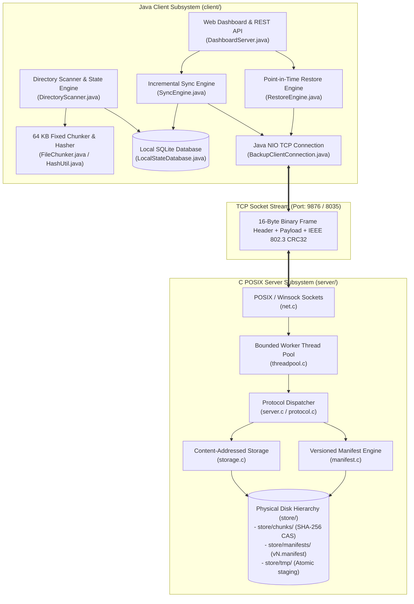
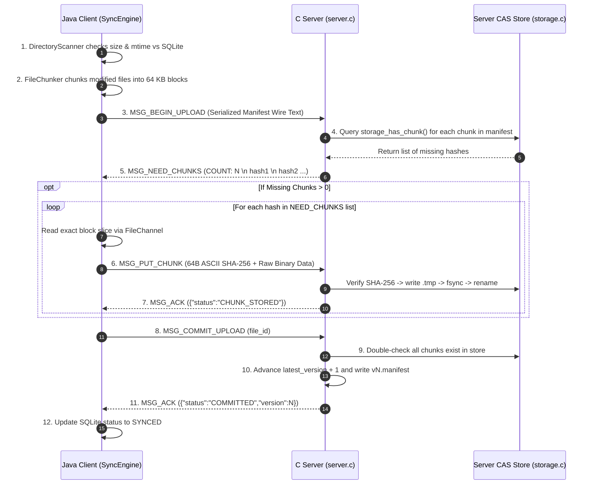
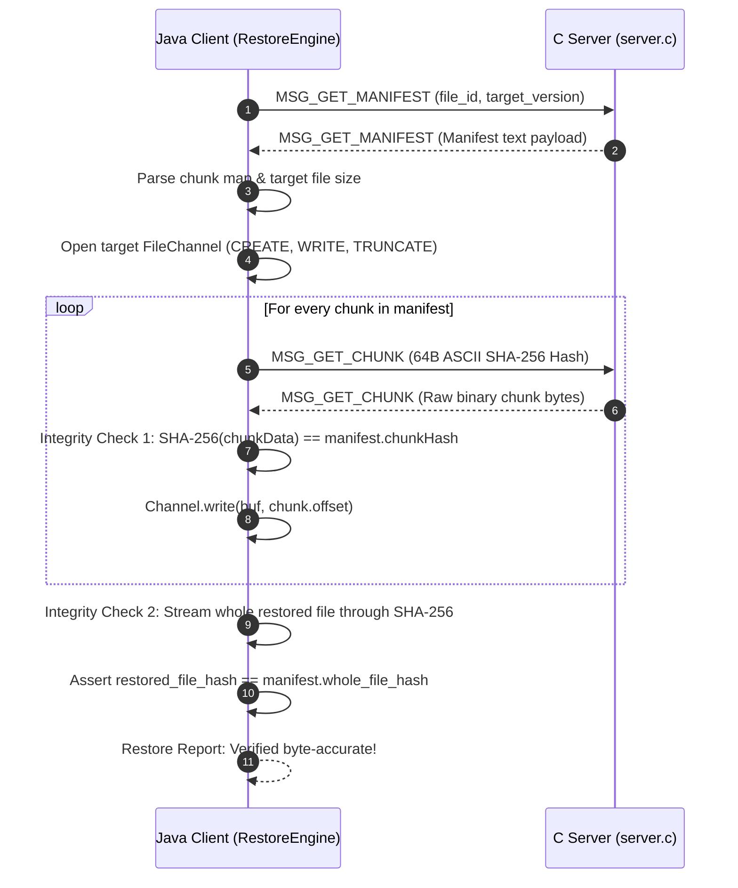
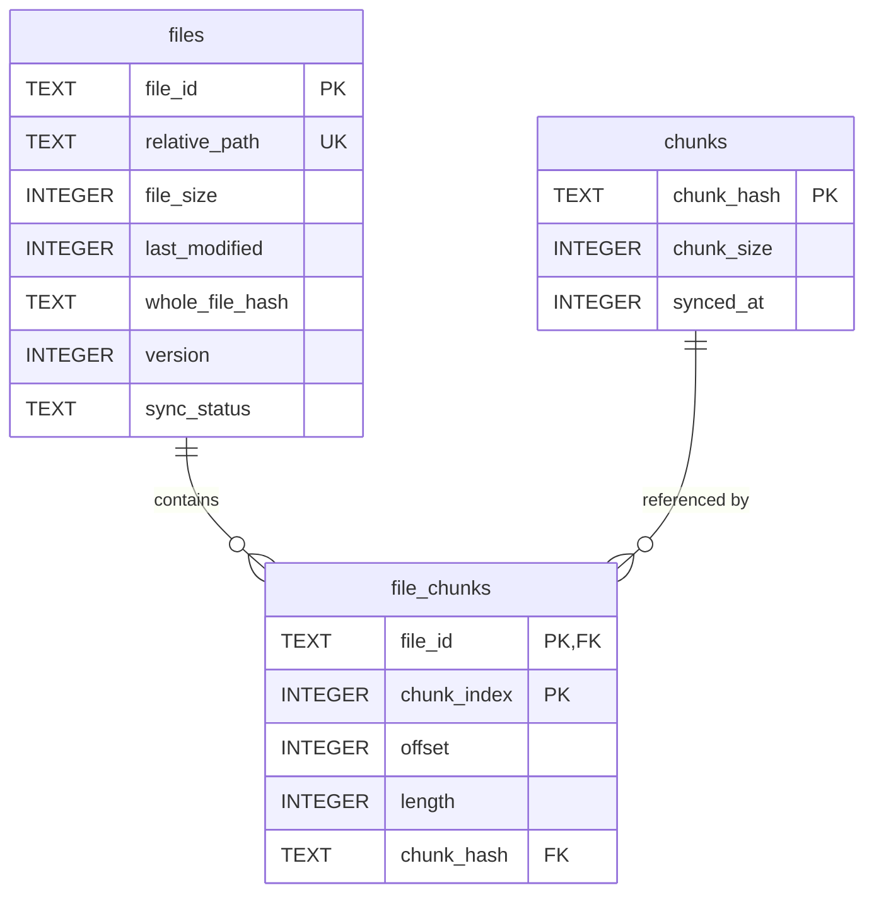

# Distributed Backup, Synchronization & Recovery System
### End-to-End Architectural Specification, Protocol Design & Engineering Reference

---

## 1. Executive Summary & Project Context

### 1.1 Academic & Practical Context
* **Course / Discipline:** Computer Networks (CN) — Semester 5 Mini-Project
* **Project Title:** Distributed Backup, Synchronization & Recovery System
* **Core Domains:** Transport Layer Systems, Application Layer Protocol Design, Content-Addressed Storage (CAS), Block-Level Data Deduplication, Point-in-Time Historical Recovery, Cross-Language Systems Interoperability (C / Java).

### 1.2 Motivation & Problem Statement
Traditional network backup solutions (such as basic FTP/SFTP mirroring or naive HTTP file uploads) repeatedly transfer entire file payloads across the network regardless of whether only a single byte was altered. For large files (e.g., virtual machine images, databases, multimedia assets, disk images), this approach results in:
1. Massive network bandwidth waste and transmission latency.
2. Server storage explosion caused by redundant identical blocks.
3. Vulnerability to transport-layer bit errors without end-to-end cryptographic integrity.
4. Vulnerability to incomplete/corrupted backups if the network drops or the server crashes mid-transfer.

### 1.3 System Overview & Key Achievements
This project designs and implements an enterprise-grade, distributed backup, delta synchronization, and point-in-time recovery platform. It features:
* **Custom Application-Layer Binary Framing Protocol (BS-Protocol):** A high-throughput, 16-byte fixed binary header over raw TCP sockets, featuring per-frame IEEE 802.3 CRC32 verification and request-response correlation.
* **Content-Addressed Storage (CAS):** 64 KB block chunking where blocks are addressed immutably by their cryptographic SHA-256 hexadecimal hash (`store/chunks/<sha256>`).
* **Surgical Incremental Uploads:** A 4-step synchronization handshake (`BEGIN_UPLOAD` $\rightarrow$ `NEED_CHUNKS` $\rightarrow$ `PUT_CHUNK` $\rightarrow$ `COMMIT_UPLOAD`) that transfers **only** newly created or modified chunks.
* **Atomic Crash-Resilient Persistence:** Server writes chunks to temporary files, flushes buffers with `fsync()`, and atomically moves them into place with POSIX `rename()`, preventing corrupt partial writes.
* **Point-in-Time Recovery Engine:** Versioned manifest metadata trees allow clients to reconstruct any historical file version byte-for-byte with multi-tiered checksum verification.
* **Real-Time Web Dashboard:** An embedded Java HTTP server powered by Project Loom Virtual Threads, exposing a REST API and a single-page management dashboard.
* **Cross-Language Systems Design:** Seamless interoperability between a high-performance C backend (C99, POSIX threads, Winsock/POSIX sockets) and a modern Java NIO client engine (Java 21, NIO Channels, ByteBuffers, SQLite JDBC in WAL mode).

---

## 2. High-Level Architecture & Topology

The system operates across two core subsystems over a direct TCP connection:



---

## 3. Custom Application-Layer Binary Framing Protocol

Rather than using high-overhead HTTP/1.1 or JSON envelopes over TCP, the system defines a lean 16-byte fixed binary header followed by a variable-length binary payload.

### 3.1 16-Byte Frame Specification

All multi-byte numeric fields are encoded in **Network Byte Order (Big-Endian)**.

```text
 0                   1                   2                   3
 0 1 2 3 4 5 6 7 8 9 0 1 2 3 4 5 6 7 8 9 0 1 2 3 4 5 6 7 8 9 0 1
+-+-+-+-+-+-+-+-+-+-+-+-+-+-+-+-+-+-+-+-+-+-+-+-+-+-+-+-+-+-+-+-+
|          Magic (0x4253)       |    Version    |   Frame Type  |
+-+-+-+-+-+-+-+-+-+-+-+-+-+-+-+-+-+-+-+-+-+-+-+-+-+-+-+-+-+-+-+-+
|                          Request ID                           |
+-+-+-+-+-+-+-+-+-+-+-+-+-+-+-+-+-+-+-+-+-+-+-+-+-+-+-+-+-+-+-+-+
|                        Payload Length                         |
+-+-+-+-+-+-+-+-+-+-+-+-+-+-+-+-+-+-+-+-+-+-+-+-+-+-+-+-+-+-+-+-+
|                         Payload CRC32                         |
+-+-+-+-+-+-+-+-+-+-+-+-+-+-+-+-+-+-+-+-+-+-+-+-+-+-+-+-+-+-+-+-+
|                     Payload Data (Variable)...                |
+-+-+-+-+-+-+-+-+-+-+-+-+-+-+-+-+-+-+-+-+-+-+-+-+-+-+-+-+-+-+-+-+
```

| Byte Offset | Field Name | Data Type | Description |
| :--- | :--- | :--- | :--- |
| `0 - 1` | `magic` | `uint16_t` | Magic signature constant: `0x4253` (ASCII `'B'`, `'S'`). Rejects misdirected or desynchronized TCP streams. |
| `2` | `version` | `uint8_t` | Protocol version: `0x01`. Future-proofs the binary format. |
| `3` | `type` | `uint8_t` | Message Type opcode (see opcode table below). |
| `4 - 7` | `request_id` | `uint32_t` | Client-generated sequential correlation ID for matching requests to responses. |
| `8 - 11` | `payload_len` | `uint32_t` | Exact length of following payload in bytes ($0 \le \text{len} \le 16\text{ MB}$). |
| `12 - 15`| `crc32` | `uint32_t` | IEEE 802.3 CRC32 checksum computed over the payload data (0 if payload length is 0). |

### 3.2 Protocol Opcode Table

Defined in [`server/include/protocol.h`](file:///home/karan/Data/Academics/sem-5/Mini-project/CN/Source/Distributed_Backup_Synchronization_&_Recovery_System_Full_Analysis/server/include/protocol.h) and [`client/src/main/java/com/backup/protocol/MessageType.java`](file:///home/karan/Data/Academics/sem-5/Mini-project/CN/Source/Distributed_Backup_Synchronization_&_Recovery_System_Full_Analysis/client/src/main/java/com/backup/protocol/MessageType.java):

| Opcode Hex | Symbolic Name | Sender | Payload Format | Description |
| :---: | :--- | :---: | :--- | :--- |
| `0x01` | `MSG_HELLO` | Client | UTF-8 JSON String | Initial handshake establishing client capabilities (e.g. `{"client":"JavaNIO"}`). |
| `0x02` | `MSG_HELLO_RESP` | Server | UTF-8 JSON String | Handshake response acknowledging protocol version and server build. |
| `0x03` | `MSG_ACK` | Server/Client | Text / JSON | Generic operational success acknowledgement. |
| `0x04` | `MSG_ERROR` | Server/Client | UTF-8 Error Message | Reports protocol violations, CRC mismatches, or storage errors. |
| `0x10` | `MSG_BEGIN_UPLOAD` | Client | Wire Manifest String | Submits candidate file manifest to query which chunks must be transmitted. |
| `0x11` | `MSG_NEED_CHUNKS` | Server | Text Hash List | Responds with count and 64-char SHA-256 hashes of chunks missing in store. |
| `0x12` | `MSG_PUT_CHUNK` | Client | Binary (64B Hash + Data) | Uploads a single chunk: 64 bytes ASCII SHA-256 followed by raw chunk bytes. |
| `0x13` | `MSG_COMMIT_UPLOAD`| Client | UTF-8 File ID String | Asks server to finalize file version once all chunks are present. |
| `0x20` | `MSG_GET_MANIFEST` | Client | Text (`<file_id> [v]`) | Requests stored manifest for a file ID and optional version number. |
| `0x21` | `MSG_GET_CHUNK` | Client | 64B ASCII SHA-256 | Requests raw binary data of an individual chunk by its SHA-256 digest. |

### 3.3 IEEE 802.3 CRC32 Validation
Every frame carrying payload data is verified at both boundaries:
* **Client Sender:** [`Crc32Util.java`](file:///home/karan/Data/Academics/sem-5/Mini-project/CN/Source/Distributed_Backup_Synchronization_&_Recovery_System_Full_Analysis/client/src/main/java/com/backup/protocol/Crc32Util.java) computes the polynomial checksum and populates bytes 12–15.
* **Server Receiver:** [`server.c`](file:///home/karan/Data/Academics/sem-5/Mini-project/CN/Source/Distributed_Backup_Synchronization_&_Recovery_System_Full_Analysis/server/src/server.c#L319-L327) recalculates the CRC32 checksum over the received byte buffer using a precomputed lookup table ([`crc32.c`](file:///home/karan/Data/Academics/sem-5/Mini-project/CN/Source/Distributed_Backup_Synchronization_&_Recovery_System_Full_Analysis/server/src/crc32.c)). If computed CRC $\ne$ header CRC, the frame is rejected immediately with `MSG_ERROR` and the connection drops.

---

## 4. Content-Addressed Storage (CAS) & Deduplication Engine

### 4.1 Storage Directory Layout
The server maintains an isolated, content-addressed filesystem tree ([`storage.c`](file:///home/karan/Data/Academics/sem-5/Mini-project/CN/Source/Distributed_Backup_Synchronization_&_Recovery_System_Full_Analysis/server/src/storage.c)):
```
store/
├── chunks/             <-- Content-addressed chunks (SHA-256 hex filename)
│   ├── 63f388055843b479eabb911d2deed298f6259169bd5d03eb0d53d4be99774cc3
│   ├── 266b850d74d04a9316b0f129ccddcb7600305215fd65e4aba3b6c5c9341abf49
│   └── ...
├── manifests/          <-- Versioned file manifests indexed by File ID
│   ├── 74ca9961a669d5cd/
│   │   ├── v1.manifest
│   │   ├── v2.manifest
│   │   └── v3.manifest
│   └── 688066e7e2b0a9fa/
│       └── v1.manifest
└── tmp/                <-- Staging directory for atomic writes
    └── 63f388055...9774cc3.38291.65536.tmp
```

### 4.2 Deduplication Model (64 KB Fixed-Size Blocks)
Files are sliced into uniform blocks of size $S = 65,536\text{ bytes}$ (64 KB). The last block takes the residual size $r \le S$.
* **Intra-File Deduplication:** Multiple identical regions within a file produce identical SHA-256 digests and map to the same stored chunk.
* **Inter-File Deduplication:** Identical files or files with duplicate sub-blocks across folders reference the same chunks on disk.
* **Inter-Version Deduplication:** Modifying 1 byte inside a 16 MB file only mutates 1 block out of 256; the remaining 255 blocks are reused across versions without rewriting disk storage.

### 4.3 Atomic Persistence via Two-Phase Commit & `fsync()`
To prevent file corruption during server crashes or sudden power loss:
```text
[Incoming Chunk Data]
         │
         ▼
 1. Check if hash exists in store/chunks/<hash>?
         ├── (Yes) ──> Return 0 immediately (Deduplicated, zero write)
         └── (No)
                 ▼
 2. Write data to store/tmp/<hash>.<rand>.<len>.tmp
                 ▼
 3. Execute fsync(fileno(file)) to flush OS page caches to physical disk
                 ▼
 4. POSIX atomic rename(tmp_path, store/chunks/<hash>)
```
Because POSIX `rename()` is an atomic directory operation within the same filesystem, readers either see the old state or the completely written, persisted chunk—never an incomplete or corrupted file.

### 4.4 Wire Manifest Format
Manifests ([`manifest.c`](file:///home/karan/Data/Academics/sem-5/Mini-project/CN/Source/Distributed_Backup_Synchronization_&_Recovery_System_Full_Analysis/server/src/manifest.c) / [`ManifestWireUtil.java`](file:///home/karan/Data/Academics/sem-5/Mini-project/CN/Source/Distributed_Backup_Synchronization_&_Recovery_System_Full_Analysis/client/src/main/java/com/backup/protocol/ManifestWireUtil.java)) describe how to assemble chunks into a file:
```text
FILE_ID:74ca9961a669d5cd
FILE_PATH:backup_payload.bin
TIMESTAMP:1791478130608
FILE_SIZE:16777216
FILE_HASH:f18b2558cc994be7b9d7a8cf1033e3c24087acd4ecc57ecba36992c02db6b8bf
CHUNK_COUNT:256
CHUNKS_BEGIN
0 65536 63f388055843b479eabb911d2deed298f6259169bd5d03eb0d53d4be99774cc3
65536 65536 266b850d74d04a9316b0f129ccddcb7600305215fd65e4aba3b6c5c9341abf49
131072 65536 dd9cab5e88d7def3a7841ec11cb9fe76860e4737388329673d76fac0abd35835
...
CHUNKS_END
```

---

## 5. Incremental Synchronization Flow (Phase 3)

The synchronization pipeline is implemented in [`SyncEngine.java`](file:///home/karan/Data/Academics/sem-5/Mini-project/CN/Source/Distributed_Backup_Synchronization_&_Recovery_System_Full_Analysis/client/src/main/java/com/backup/sync/SyncEngine.java) and [`server.c`](file:///home/karan/Data/Academics/sem-5/Mini-project/CN/Source/Distributed_Backup_Synchronization_&_Recovery_System_Full_Analysis/server/src/server.c):



### 5.1 Bandwidth Savings Analysis (16 MB File Benchmark)

| Scenario | Total File Size | Chunks Total | Chunks Uploaded | Bandwidth Transferred | Bandwidth Saved |
| :--- | :---: | :---: | :---: | :---: | :---: |
| **Initial Backup (Pass 1)** | 16 MB | 256 | 256 | 16,777,216 B | **0.0%** (Full upload) |
| **Single-Chunk Mutation (Pass 2)** | 16 MB | 256 | **1** | **65,536 B** | **99.61%** saved |
| **Exact Copy / Duplicate (Pass 3)** | 16 MB | 256 | **0** | **0 B** | **100.0%** saved |

---

## 6. Point-in-Time Recovery & Multi-Tier Integrity Verification (Phase 4)

Restoration is handled by [`RestoreEngine.java`](file:///home/karan/Data/Academics/sem-5/Mini-project/CN/Source/Distributed_Backup_Synchronization_&_Recovery_System_Full_Analysis/client/src/main/java/com/backup/restore/RestoreEngine.java):



### Multi-Tiered Cryptographic Integrity Protection
1. **Transport Layer Integrity (Per Frame):** IEEE 802.3 CRC32 ensures that network transmission glitches, truncated frames, or socket bit-flips are detected immediately.
2. **Block Layer Integrity (Per Chunk):** SHA-256 validation verifies that each downloaded chunk matches its expected hash before being written to disk.
3. **File Layer Integrity (End-to-End):** Once all chunks are assembled, a full SHA-256 digest is calculated over the entire file and compared against `manifest.whole_file_hash`. If a discrepancy is found, the file is deleted immediately.

---

## 7. Concurrency & Systems Engineering

### 7.1 C Server Thread Pool Architecture
Implemented in [`threadpool.c`](file:///home/karan/Data/Academics/sem-5/Mini-project/CN/Source/Distributed_Backup_Synchronization_&_Recovery_System_Full_Analysis/server/src/threadpool.c):
* **Thread Count:** 8 worker threads (`WORKER_THREADS = 8`).
* **Task Queue:** Bounded FIFO circular buffer of 64 tasks (`TASK_QUEUE_CAPACITY = 64`).
* **Condition Variables:**
  * `notify_not_empty`: Worker threads sleep when the queue is empty and wake up when new client sockets arrive.
  * `notify_not_full`: Blocks the listener thread if all 64 queue slots are full, preventing out-of-memory errors during traffic bursts.
* **Signal Handling:** Catches `SIGINT` and `SIGTERM` for graceful shutdown, allowing in-flight tasks to finish and flushing open sockets.

### 7.2 Java Client Networking
Implemented in [`BackupClientConnection.java`](file:///home/karan/Data/Academics/sem-5/Mini-project/CN/Source/Distributed_Backup_Synchronization_&_Recovery_System_Full_Analysis/client/src/main/java/com/backup/net/BackupClientConnection.java):
* **Java NIO SocketChannel:** Uses blocking NIO mode for deterministic frame sequencing.
* **TCP Tuning:** Calls `socket().setTcpNoDelay(true)` to disable Nagle's algorithm, preventing unnecessary 40 ms acknowledgment delays on small control frames.
* **Exact Read/Write Semantics:** Implements `readFully()` and `writeFully()` loops over `ByteBuffer` to handle TCP fragmentation across packet boundaries.

---

## 8. Client Local State Management (SQLite Engine)

Metadata persistence on the client is managed by [`LocalStateDatabase.java`](file:///home/karan/Data/Academics/sem-5/Mini-project/CN/Source/Distributed_Backup_Synchronization_&_Recovery_System_Full_Analysis/client/src/main/java/com/backup/storage/LocalStateDatabase.java):



* **WAL Mode:** Configured with `PRAGMA journal_mode=WAL;` and `PRAGMA foreign_keys=ON;` for fast concurrent read/write performance.
* **Short-Circuit Scanning:** Checks filesystem `(file_size, last_modified)` against the database before reading file contents. If unchanged, chunking and hashing are skipped, allowing directory scans to complete in milliseconds.

---

## 9. Web Management Dashboard & REST Interface

Implemented in [`DashboardServer.java`](file:///home/karan/Data/Academics/sem-5/Mini-project/CN/Source/Distributed_Backup_Synchronization_&_Recovery_System_Full_Analysis/client/src/main/java/com/backup/web/DashboardServer.java) using Java's built-in `HttpServer` with Project Loom Virtual Threads (`Executors.newVirtualThreadPerTaskExecutor()`):

### 9.1 REST API Specification
* `GET /` — Serves the single-page application ([`index.html`](file:///home/karan/Data/Academics/sem-5/Mini-project/CN/Source/Distributed_Backup_Synchronization_&_Recovery_System_Full_Analysis/client/src/main/resources/web/index.html)).
* `GET /api/stats` — Returns overall storage metrics:
  ```json
  {
    "totalFiles": 1,
    "uniqueChunks": 256,
    "chunkRefs": 256,
    "totalBytes": 16777216,
    "dedupRatio": 0.00,
    "savedBytes": 0
  }
  ```
* `GET /api/files` — Returns all tracked files with versions and sync states:
  ```json
  [
    {
      "fileId": "74ca9961a669d5cd",
      "relativePath": "backup_payload.bin",
      "fileSize": 16777216,
      "lastModified": 1791478456446,
      "wholeFileHash": "f18b2558cc994be7b9d7a8cf1033e3c24087acd4ecc57ecba36992c02db6b8bf",
      "version": 1,
      "syncStatus": "SYNCED",
      "chunkCount": 256
    }
  ]
  ```
* `GET /api/manifest?fileId=74ca9961a669d5cd&version=1` — Returns the detailed chunk layout for visual inspection.
* `POST /api/sync` — Triggers an on-demand directory scan and incremental upload to the C storage server.
* `POST /api/restore` — Accepts `{"fileId":"...", "version":1, "targetDir":"./restored_files"}` to initiate point-in-time recovery.

---

## 10. Codebase Structure & Symbol Map

```text
.
├── client/
│   ├── bin/                             <-- Compiled Java class files
│   ├── lib/                             <-- Third-party JAR libraries
│   │   ├── slf4j-api-2.0.12.jar
│   │   ├── slf4j-simple-2.0.12.jar
│   │   └── sqlite-jdbc-3.45.2.0.jar
│   ├── src/main/
│   │   ├── java/com/backup/
│   │   │   ├── ClientMain.java          <-- Phase 1: Protocol framing test
│   │   │   ├── Phase2TestMain.java      <-- Phase 2: Chunker & SQLite test
│   │   │   ├── Phase3SyncTestMain.java  <-- Phase 3: Incremental sync test
│   │   │   ├── Phase4RestoreAndUiMain.java <-- Phase 4: Restore & UI test
│   │   │   ├── crypto/HashUtil.java     <-- SHA-256 helper
│   │   │   ├── model/
│   │   │   │   ├── Chunk.java           <-- Chunk data model
│   │   │   │   └── FileSnapshot.java    <-- File snapshot model
│   │   │   ├── net/
│   │   │   │   └── BackupClientConnection.java <-- Java NIO TCP client
│   │   │   ├── protocol/
│   │   │   │   ├── Crc32Util.java       <-- IEEE 802.3 CRC32 helper
│   │   │   │   ├── FrameHeader.java     <-- 16-byte binary header
│   │   │   │   ├── ManifestWireUtil.java<-- Manifest wire serializer
│   │   │   │   ├── MessageType.java     <-- Protocol opcode enum
│   │   │   │   └── ProtocolFrame.java   <-- Complete frame model
│   │   │   ├── restore/
│   │   │   │   ├── RestoreEngine.java   <-- Reconstructs files from chunks
│   │   │   │   └── RestoreReport.java   <-- Restore metrics report
│   │   │   ├── storage/
│   │   │   │   ├── DirectoryScanner.java<-- Fast directory scanner
│   │   │   │   ├── FileChunker.java     <-- 64 KB block chunker
│   │   │   │   └── LocalStateDatabase.java <-- SQLite state manager
│   │   │   ├── sync/
│   │   │   │   ├── SyncEngine.java      <-- Incremental upload engine
│   │   │   │   └── SyncReport.java      <-- Sync performance metrics
│   │   │   └── web/DashboardServer.java <-- REST API & Web server
│   │   └── resources/web/index.html     <-- Web management dashboard
│   └── sync_state.db                    <-- SQLite database file
├── server/
│   ├── Makefile                         <-- Cross-platform build script
│   ├── include/
│   │   ├── crc32.h                      <-- CRC32 interface
│   │   ├── hash.h                       <-- SHA-256 interface
│   │   ├── manifest.h                   <-- Manifest interface
│   │   ├── net.h                        <-- Sockets interface
│   │   ├── protocol.h                   <-- Binary protocol definitions
│   │   ├── storage.h                    <-- CAS storage interface
│   │   └── threadpool.h                 <-- Worker thread pool interface
│   └── src/
│       ├── crc32.c                      <-- CRC32 table calculation
│       ├── hash.c                       <-- Portable SHA-256 engine
│       ├── manifest.c                   <-- Manifest serializer/parser
│       ├── net.c                        <-- recv_exact() & send_all()
│       ├── protocol.c                   <-- Header encode/decode
│       ├── server.c                     <-- Main server & message router
│       ├── storage.c                    <-- Atomic chunk storage
│       ├── test_storage.c               <-- Unit tests for C engine
│       └── threadpool.c                 <-- Mutex/Condvar worker pool
└── store/                               <-- Content-addressed repository
    ├── chunks/                          <-- SHA-256 chunk files
    ├── manifests/                       <-- Versioned manifest files
    └── tmp/                             <-- Staging directory for writes
```

---

## 11. Build, Compilation & Verification Guide

### 11.1 Prerequisites
* **C Compiler:** GCC (v9+ recommended) with `pthread` support.
* **Java Development Kit:** Java 21 or newer (Virtual Threads support required).
* **Build Utilities:** GNU Make, SQLite3 CLI.

> [!IMPORTANT]
> If multiple Java versions are installed on your system, verify that Java 21+ is active:
> ```bash
> export JAVA_HOME=/usr/lib/jvm/java-21-openjdk-amd64
> export PATH=$JAVA_HOME/bin:$PATH
> java -version
> ```

---

### 11.2 Step 1: Compiling and Testing the C Storage Server

```bash
# Navigate to server directory and build binary
cd server
make clean
make

# Run the self-contained C unit and integration tests:
gcc -Wall -Wextra -Iinclude src/crc32.c src/hash.c src/storage.c src/manifest.c src/test_storage.c -o test_storage
./test_storage
```

**Expected Test Output:**
```text
========================================================
  Distributed Backup System - C Storage & Hash Engine  
  Phase 2: Self-Contained Unit & Integration Tests      
========================================================
[PASS] NIST SHA-256 test vector matched!
[PASS] Storage initialized at ./test_store
[PASS] Chunk written atomically!
[PASS] Chunk presence confirmed!
[PASS] Deduplication confirmed: zero duplicate writes!
[PASS] Chunk read and verified byte-for-byte!
[PASS] Saved manifest version 1!
[PASS] Loaded and parsed manifest version 1 cleanly!
[PASS] Latest version confirmed as 1!
========================================================
  All C Storage Engine Tests PASSED successfully!
========================================================
```

---

### 11.3 Step 2: Compiling the Java Client Engine

Run from the project root directory:
```bash
# Compile all Java source files into client/bin/ using Java 21+
$JAVA_HOME/bin/javac -cp "client/lib/*" -d client/bin $(find client/src/main/java -name "*.java")
```

---

### 11.4 Step 3: Running the Phase-by-Phase Test Suite

#### Phase 1: Protocol Framing & Handshake Verification
Starts the C server and tests basic framing, request IDs, and CRC32 checks over TCP.

```bash
# Terminal 1: Start C server on port 8035
./server/server 8035

# Terminal 2: Run Phase 1 client test
$JAVA_HOME/bin/java -cp "client/bin:client/lib/*" com.backup.ClientMain 127.0.0.1 8035
```

---

#### Phase 2: Local Deduplication & SQLite State Engine
Tests local 64 KB block chunking, directory change detection, and cross-file deduplication.

```bash
$JAVA_HOME/bin/java -cp "client/bin:client/lib/*" com.backup.Phase2TestMain
```

---

#### Phase 3: Incremental Sync Flow Benchmark
Generates a 16 MB test file, performs a full initial backup, modifies a single chunk, and verifies 99.6% bandwidth savings.

```bash
# Terminal 1: Ensure C server is running on port 8035
./server/server 8035

# Terminal 2: Run Phase 3 test (16 MB test payload)
$JAVA_HOME/bin/java -cp "client/bin:client/lib/*" com.backup.Phase3SyncTestMain 16
```

---

#### Phase 4: Point-in-Time Restore & Web Dashboard
Starts the Web Dashboard at `http://127.0.0.1:8080`, downloads chunks from the C server, and reconstructs both Version 1 and Version 2 byte-for-byte.

```bash
# Terminal 1: Ensure C server is running on port 8035
./server/server 8035

# Terminal 2: Start Web UI and run verification suite
$JAVA_HOME/bin/java -cp "client/bin:client/lib/*" com.backup.Phase4RestoreAndUiMain --daemon
```

Open `http://127.0.0.1:8080` in any web browser to view the interactive dashboard:

```text
+---------------------------------------------------------------------------------+
|  Distributed Backup & Recovery Dashboard                                        |
|  [Files: 1]  [Unique Chunks: 256]  [Dedup Ratio: 0.0%]  [Saved: 0 KB]            |
+---------------------------------------------------------------------------------+
|  Tracked Files:                                                                 |
|  backup_payload.bin  | 16.0 MB | v2 | SYNCED | [View Chunks] [Restore]          |
+---------------------------------------------------------------------------------+
```

---

## 12. Engineering Roadmap & Future Scope

1. **Content-Defined Chunking (CDC):** Replace fixed 64 KB boundaries with FastCDC or Rabin Fingerprinting so that inserting bytes at the beginning of a file does not invalidate subsequent chunk boundaries.
2. **Transport Layer Security (TLS 1.3):** Integrate OpenSSL/mbedTLS on the C server and `SSLEngine` on the Java client to encrypt chunk transmissions over untrusted networks.
3. **Stream Compression:** Add LZ4 or Zstandard block compression to compress chunk payloads before transmission, reducing network bandwidth for text and log datasets.
4. **Storage Garbage Collection:** Implement a mark-and-sweep garbage collector in `server/src/storage.c` to identify and remove unreferenced chunks when older manifest versions are deleted.
5. **Distributed Multi-Server Replication:** Expand the C server into a clustered peer topology using Raft consensus for active-active backup redundancy.
